# React／Frontendにおける単体テストと結合テストの境界

**Frontendのテストは、単体テストと結合テストの間にFrontend内部結合テストを置いた4段階で分ける。境界は、使う道具や実行環境ではなく、個別の責務を検証するのか、責務間の連携を検証するのかで引く。**

## 1. 単体テストと結合テストの境界をどう定義するか

Reactを用いたFrontend開発では、テスト対象の大きさ、実行環境、依存先との接続範囲を分けて考える必要があります。

コンポーネント単位だから単体テスト、ブラウザを使用するから結合テスト、という分類は適切ではありません。コンポーネントの大きさ、ブラウザという実行環境、Backendへの接続の有無は、それぞれ別の軸だからです。この3つが混ざったままだと、同じテストを単体と呼ぶ人と結合と呼ぶ人が出て、どの工程で何を保証したのかが判断できなくなります。

受託開発の工程として整理するなら、依存先との接続範囲によって、次の4段階に分けることを推奨します。外側に進むほど、実際のシステム構成に近づきます。[^istqb]

| テスト区分 | 検証対象 | API接続 |
| --- | --- | --- |
| Frontend単体テスト（FE単体） | 関数、Hooks、コンポーネントなど、個別の責務 | なし／Mock |
| Frontend内部結合テスト（FE内部結合） | 複数のコンポーネント、状態管理、画面、ルーティングの連携 | 原則Mock |
| Frontend・Backend結合テスト（FE・BE結合） | API通信、データ連携、認証認可、永続化 | 実API |
| システムテスト（ST） | 業務シナリオ、システム全体としての要求充足 | 実API／外部接続等 |

Hooksは、Reactで状態や副作用をコンポーネントから切り出す仕組みです。Mockは、MSW（Mock Service Worker。ブラウザやNode.jsでHTTP応答を模擬するライブラリ）などでAPIの応答を模擬することを指します。

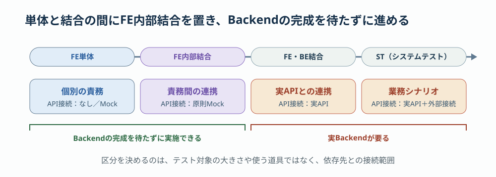

重要なのは、従来の開発における「単体テスト→結合テスト」という2段階の間に、**Frontend内部結合テストという独立した区分を設けること**です。

Frontend内部結合テストは、Backendの完成を待たずに実施できます。

## 2. 境界はどこにあるか：顧客検索画面の例

例えば、顧客検索画面を考えます。この画面は、検索フォーム（SearchForm）と検索結果テーブル（CustomerTable）の2つのコンポーネント、検索条件の状態を持つカスタムHook（useCustomerSearch）、入力制約を定義するバリデーションSchemaとデータ変換の関数、Backendと通信するAPI Clientからできています。

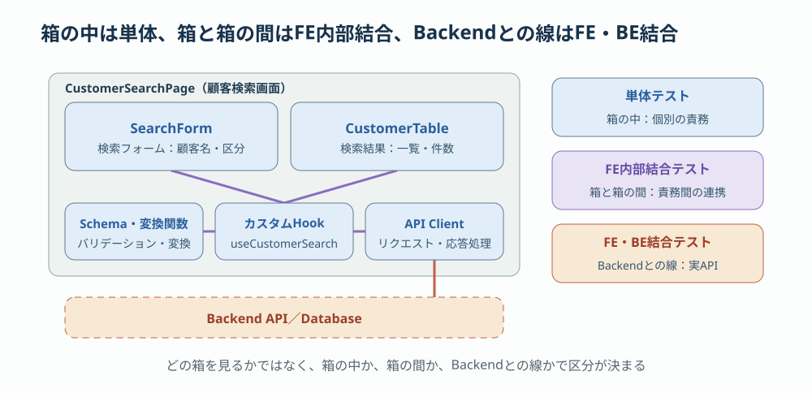

**個別の責務を検証しているのか、複数の責務間の連携を検証しているのかが、単体テストとFrontend内部結合テストの境界になります。**

図の箱の中、つまり1つのコンポーネントやHook、関数が自分の責務を果たしているかを見るのが単体テストです。箱と箱の間、つまり検索ボタンを押したら検索結果が表示される、といった複数の責務の連携を見るのがFrontend内部結合テストです。API ClientとBackendをつなぐ線を実際に通すのが、FE・BE結合テストです。

この画面のテストを分類すると、次のようになります。

| テスト内容 | テスト区分 |
| --- | --- |
| 顧客名の文字数チェック | 単体 |
| 検索条件のデータ変換 | 単体 |
| 検索ボタンの活性・非活性制御 | 単体 |
| 検索結果テーブルの表示制御 | 単体 |
| カスタムHookの状態遷移 | 単体 |
| 検索ボタン押下から検索結果表示まで | FE内部結合 |
| 検索条件とページネーションの連動 | FE内部結合 |
| APIエラー時の画面全体の表示制御 | FE内部結合 |
| 検索画面から顧客詳細画面への遷移 | FE内部結合 |
| 実APIへの検索条件の送信・応答 | FE・BE結合 |
| DB登録内容と画面表示内容の一致 | FE・BE結合 |
| 顧客登録から契約成立までの業務フロー | システム |

## 3. ブラウザを使用するかどうかは別の分類軸

Frontend開発では、テストレベルとテスト実行環境を分離して定義することが重要です。

| 実行環境 | 主なツール | 特徴 |
| --- | --- | --- |
| Node.js | Vitest | ロジック・状態管理の高速な検証 |
| 仮想DOM | Vitest、jsdom、Testing Library | UIの表示・操作の検証 |
| 実ブラウザ | Vitest Browser Mode、Storybook、Playwright | 実際の描画・操作・ブラウザ挙動の検証 |
| 実システム環境 | Playwright、MagicPod | Backendを含むシステムの検証 |

jsdomは、Node.js上でブラウザのDOMを模擬するライブラリです。Testing Libraryは、利用者から見える振る舞いでコンポーネントを検証するためのライブラリで、ReactではReact Testing Libraryを使います。Vitest Browser Modeは、Vitestのテストを実ブラウザ上で実行する機能です。[^vitest-browser] MagicPodは、実ブラウザや実機でのテストを自動化するクラウドサービスです。

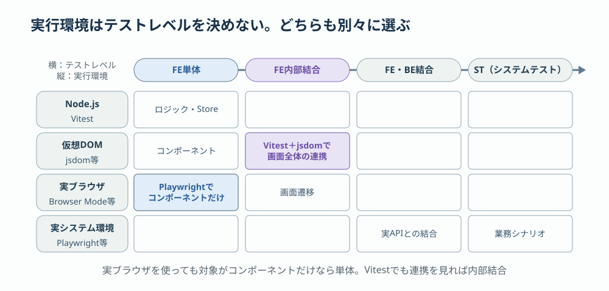

Playwrightを使用したとしても、コンポーネントだけを対象としていれば単体レベルのテストです。[^pw-ct]

逆に、Vitestを使用して複数のコンポーネントと状態管理の連携を検証する場合は、Frontend内部結合テストになります。

以降の章では、テストレベルは4段階、実行環境はそれとは別の軸として扱います。

## 4. Frontend単体テストの8種別

Frontend単体テストは、テスト対象によって次の8種類に分類できます。

| No. | テスト種別 | 主な対象 | 推奨ツール |
| --- | --- | --- | --- |
| 1 | ロジックテスト | 純粋関数、計算、データ変換 | Vitest |
| 2 | バリデーションテスト | 入力制約、Schema | Vitest、Zod |
| 3 | Hooksテスト | カスタムHook、副作用、状態遷移 | Vitest、Testing Library |
| 4 | 状態管理テスト | Store、Action、Reducer、Selector | Vitest |
| 5 | コンポーネント表示テスト | Props、条件分岐、表示内容 | Testing Library、Storybook |
| 6 | コンポーネント操作テスト | 入力、クリック、イベント | Testing Library、Storybook |
| 7 | APIクライアントテスト | リクエスト生成、応答処理 | Vitest、MSW |
| 8 | コンポーネント品質テスト | 視覚的品質、アクセシビリティ | Storybook、Playwright、axe-core |

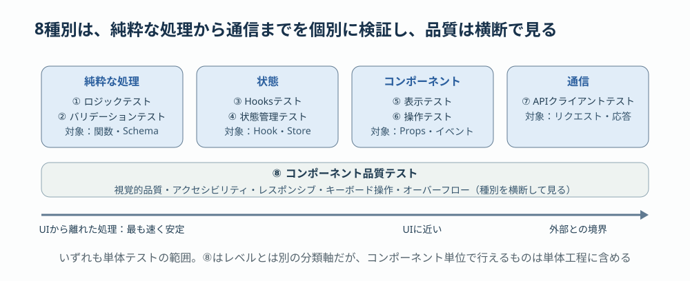

### 4.1. ロジックテスト

UIから分離された処理の正当性を検証します。

- 金額計算・端数処理
- 日付・時刻の変換
- データのソート・フィルタリング
- 表示用データへの変換
- 業務ルールに基づく判定
- 境界値・異常値処理

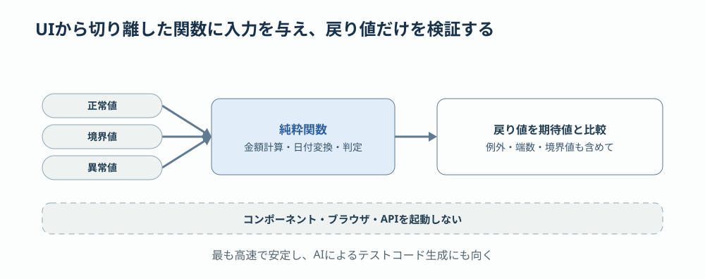

最も高速で安定しており、AIによるテストコード生成にも適しています。

### 4.2. バリデーションテスト

入力値に対する制約と判定を検証します。

- 必須入力
- 文字数・文字種
- 数値範囲
- 日付範囲
- 項目間相関チェック
- エラーメッセージの生成

Zod（TypeScript向けのSchema定義・検証ライブラリ）などで入力制約をSchemaとして分離することで、画面を起動せずに検証できます。

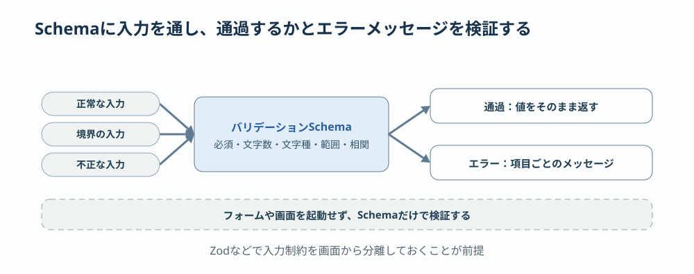

### 4.3. Hooksテスト

カスタムHookが提供するインターフェースと振る舞いを検証します。

検証対象は、初期状態、状態変更、非同期処理、エラー処理、再取得、キャンセル、リソース解放などです。

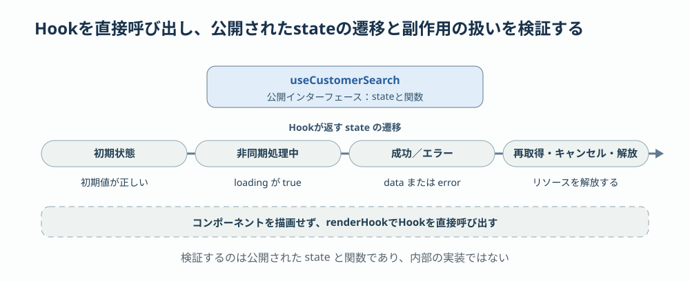

### 4.4. 状態管理テスト

ZustandやReduxなどで管理する状態（Store）と、その更新ルールを検証します。

| 操作 | 期待結果 |
| --- | --- |
| 商品追加 | 商品一覧に追加される |
| 同一商品追加 | 数量が加算される |
| 商品削除 | 対象商品が除去される |
| カート初期化 | 初期状態に戻る |
| 数量変更 | 合計金額が更新される |

Store単体で検証する場合は単体テスト、複数のコンポーネントがStoreを介して連動する場合はFrontend内部結合テストになります。

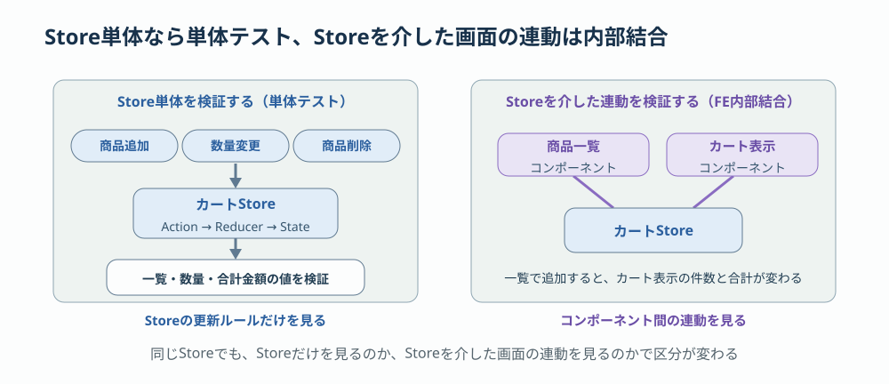

### 4.5. コンポーネント表示テスト

Propsや内部状態に対して、期待する表示が行われることを検証します。

検索結果テーブルであれば、正常、Loading、Empty、Errorの4つの表示状態があります。

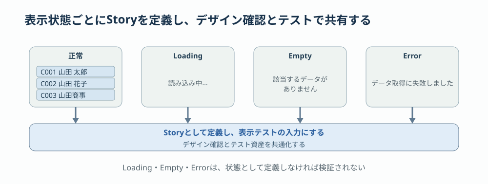

StorybookのStoryとして各状態を定義しておくことで、デザイン確認とテスト資産を共通化できます。[^storybook]

### 4.6. コンポーネント操作テスト

ユーザー操作に対するコンポーネントの振る舞いを検証します。

クリック、テキスト入力、選択、フォーカス移動、キーボード操作、ダイアログ開閉、イベント発火などが対象になります。

内部実装やStateの値ではなく、**ユーザーから観測できる結果と公開されたインターフェースを検証する**ことを原則とします。[^tl]

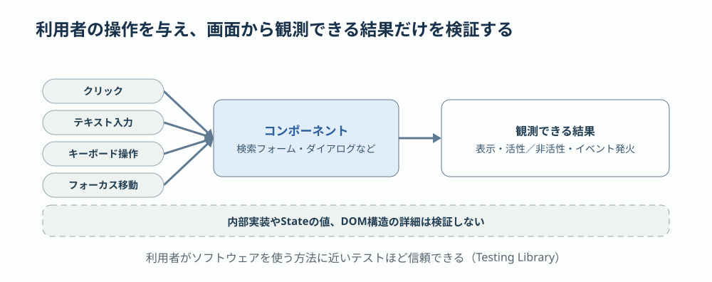

### 4.7. APIクライアントテスト

Frontend側の通信処理を、Backendから独立して検証します。

MSWなどでHTTPレスポンスを制御し、次のような振る舞いを確認します。[^msw]

| 入力・条件 | 検証内容 |
| --- | --- |
| 検索条件 | Query Parameterの生成 |
| 登録データ | Request Bodyの生成 |
| HTTP 200 | 正常応答の処理 |
| HTTP 400 | 入力エラーの処理 |
| HTTP 401・403 | 認証・認可エラーの処理 |
| HTTP 500 | サーバーエラーの処理 |
| 通信失敗 | リトライ・エラー処理 |

ただし、Mock APIによる検証では、実Backendとのインターフェース整合性までは保証できません。そこは契約テスト（OpenAPIなどのAPI定義と実装の整合を機械的に確かめるテスト）や、実APIとの結合テストで担保します。

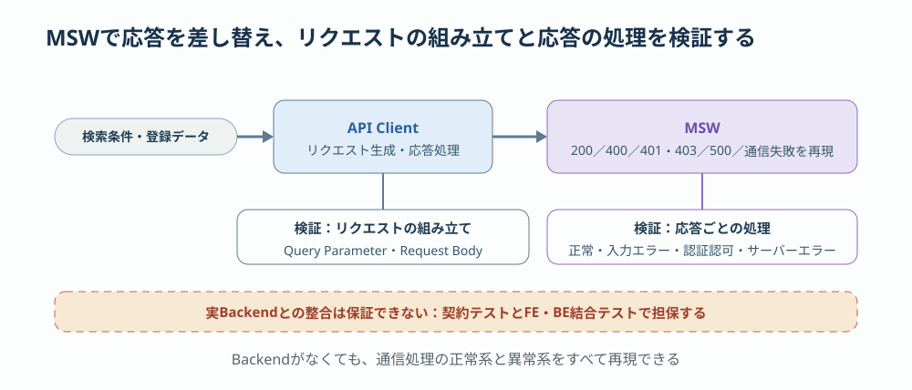

### 4.8. コンポーネント品質テスト

機能的な正しさとは異なる、UI固有の品質を検証します。

| テスト種別 | 検証内容 |
| --- | --- |
| Visual Regression Test | 意図しない外観の変化 |
| Accessibility Test | ARIA属性、ラベル、コントラスト等 |
| Responsive Test | 画面幅による表示崩れ |
| Keyboard Navigation Test | キーボードによる操作可能性 |
| Overflow Test | 長文・大量データによる表示崩れ |

Visual Regression Test（VRT）は、描画結果の画像を前回と比較して差分を検出するテストです。アクセシビリティテストの手段と確認対象は、別記事「React／Frontendにおけるアクセシビリティテストの整理」で扱います。

厳密には、これらは単体・結合というテストレベルとは別の分類軸です。ただし、コンポーネント単位で実施できるものはFrontend単体テスト工程に含めてよいと考えます。

## 5. テストレベルとテスト種別のマトリクス

テスト種別とテストレベルを混同しないために、二次元で整理します。

| テスト種別 | FE単体 | FE内部結合 | FE・BE結合 | ST |
| --- | --- | --- | --- | --- |
| ロジック | ◎ | ― | ― | ― |
| バリデーション | ◎ | ○ | ○ | ― |
| Hooks | ◎ | ○ | ― | ― |
| 状態管理 | ◎ | ◎ | ― | ― |
| UI表示 | ◎ | ◎ | ○ | ○ |
| UI操作 | ◎ | ◎ | ○ | ○ |
| API通信 | ○ | ◎ | ◎ | ○ |
| 画面遷移 | ― | ◎ | ○ | ○ |
| Visual Regression | ◎ | ◎ | ― | ― |
| アクセシビリティ | ◎ | ◎ | ― | ○ |
| レスポンシブ | ◎ | ◎ | ― | ○ |
| 認証認可 | ○ | ○ | ◎ | ◎ |
| データ永続化 | ― | ― | ◎ | ○ |
| 業務シナリオ | ― | ○ | ○ | ◎ |

凡例：◎ 主たる検証工程／○ 補完的な検証／― 原則対象外

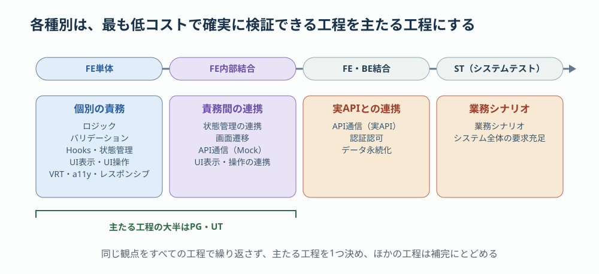

すべてのテストレベルで同じ観点を繰り返すのではなく、最も低コストで確実に検証できる工程を主たる検証工程とします。

## 6. 受託開発の工程へのマッピング

従来型の受託開発の工程（PG・UT＝プログラミングと単体テスト、IT＝結合テスト、ST＝システムテスト）に適用するなら、次のように定義することを推奨します。

ここでは、**Frontend内部結合テストをテスト技法上は結合テストと位置づけながら、プロジェクト管理上はPG・UT工程に含めます。**

| 工程 | 完了条件 |
| --- | --- |
| PG・UT | Backendに依存せずFrontendの機能要求を満たしている |
| IT | 実Backendとの連携を含めて機能要求を満たしている |
| ST | システム全体として業務要求・非機能要求を満たしている |

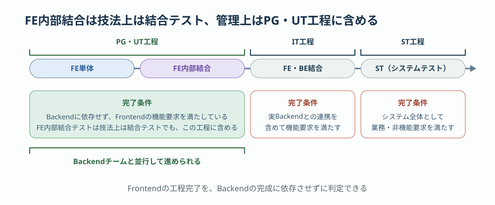

この定義であれば、FrontendチームとBackendチームの並行開発を成立させやすくなります。

## 7. 推奨技術スタックとテストアーキテクチャ

React／Next.jsを前提とした標準テスト基盤は、次の構成がよいと考えます。

| ツール | 主たる責務 |
| --- | --- |
| Vitest | ロジック、Schema、Hooks、Store |
| React Testing Library | コンポーネント表示・操作、内部結合 |
| Storybook | コンポーネント状態の定義・操作・品質検証 |
| MSW | API依存の分離、異常系レスポンスの再現 |
| Playwright | 実ブラウザ検証、画面遷移、実API結合 |
| axe-core | アクセシビリティの自動検証 |
| OpenAPI | API契約の定義・整合性検証の基準 |

テストの配分は、下の層ほど速く安定し数が多く、上に行くほど実環境に近づく、という形になります。

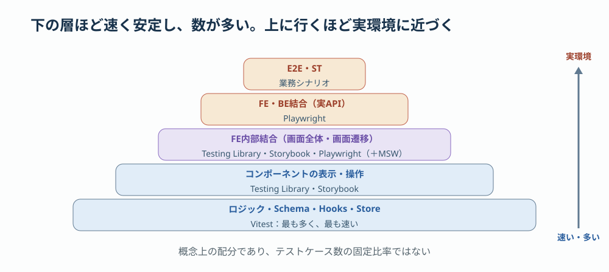

※ 図は概念上のテスト配分であり、テストケース数の固定比率を示すものではありません。

## 8. AI駆動開発では、何を入力にどのテストを生成するか

AIにテストを生成させる場合も、「この画面のテストを作って」という1つの指示に集約するより、テスト種別とテストレベルごとに、どの成果物を入力にして、どのテストを生成するかを分けて定義する方がよいと考えます。生成の単位は、§4の8種別と§1の4段階に対応させます。

| テストレベル | 生成するテスト | インプットにする成果物 | 生成物 |
| --- | --- | --- | --- |
| FE単体 | ロジックテスト | 関数のソースコード、業務ルールの仕様 | Vitest |
| FE単体 | バリデーションテスト | Zod Schema、項目定義（必須・桁・型・範囲） | Vitest |
| FE単体 | Hooksテスト | Hookのソースコード、状態遷移の定義 | Vitest、Testing Library |
| FE単体 | 状態管理テスト | Storeの定義、状態遷移の定義 | Vitest |
| FE単体 | コンポーネント表示・操作テスト | Props定義、コンポーネント仕様、表示状態の一覧 | Testing Library、Storybook（Storyとplay関数） |
| FE単体 | Visual Regression Test | Story、承認済みの基準画像 | Storybook、Playwright（スクリーンショット比較） |
| FE単体 | Accessibility Test | Story、ARIA・ラベルの実装規約 | Storybook、Playwright、axe-core |
| FE単体 | Responsive Test | Story、ブレークポイントの定義 | Storybook（Viewport）、Playwright |
| FE単体 | Keyboard Navigation Test | Story、フォーカス順・キー操作の仕様 | Testing Library、Playwright |
| FE単体 | Overflow Test | Story、長文・大量データのテストデータ | Storybook、Playwright |
| FE単体 | APIクライアントテスト | OpenAPI定義、通信処理のソースコード | Vitest、MSW |
| FE内部結合 | 画面・画面遷移のテスト | 画面仕様、画面遷移、状態遷移、OpenAPI定義 | Testing Library、Playwright、MSW |
| FE・BE結合 | 実APIとの結合テスト | OpenAPI定義、結合テスト仕様 | Playwright（実API） |
| ST | 業務シナリオのテスト | 業務フロー、システム要求 | Playwright |

コンポーネント表示・操作テストでは、Testing Libraryのテストコードだけでなく、StorybookのStoryと、Story上で操作を再生するplay関数も生成物です。生成したStoryは、次の品質テストの入力になります。

コンポーネント品質テストは、§4.8の5つの観点ごとに行を分けています。Storyは共通の入力ですが、観点ごとに基準画像、実装規約、ブレークポイント、操作仕様、テストデータと、加えて渡す成果物が異なるからです。

表のとおり、単体テストとFrontend内部結合テストでは、AIに与えるべき情報の粒度が異なります。

単体テストではソースコードと個別仕様が中心になります。一方、Frontend内部結合テストでは、画面仕様、画面遷移、状態遷移、API契約など、複数の成果物間の関係を理解させる必要があります。

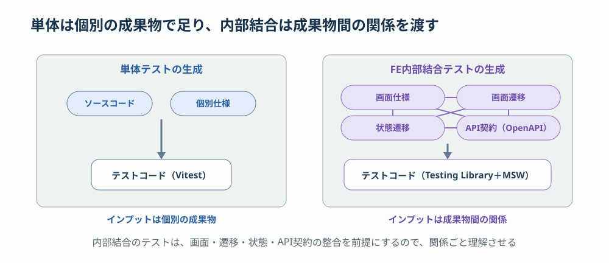

インプットが揃っていない種別のテストは、AIでも生成できません。入力制約が画面のコードに埋め込まれていればバリデーションテストは切り出せず、OpenAPI定義がなければAPIクライアントテストとFrontend内部結合テストのMockは手書きになります。テスト生成を前提にするなら、Schema、Story、状態遷移、OpenAPI定義といった成果物を先に整えることが、生成の単位を分けることと同じくらい重要です。

## 9. おわりに：Frontend単体テストの完了を何で判断するか

単体テストの完了条件を、コードカバレッジやコンポーネント単体の動作確認だけで定義してはいけません。

Frontend開発工程としての完成判定は、次の条件で定義することを推奨します。

- 個々のロジック、コンポーネント、Hooks、Storeの責務が検証されている。
- 正常系・異常系・境界値・主要な表示状態が検証されている。
- Mock APIを利用して画面全体の機能が検証されている。
- 画面内および画面間の状態・操作の連携が検証されている。
- 実Backendとの結合によって初めて検証可能になる事項が明確に分離されている。

## 参考文献・注記

[^istqb]: ISTQB, *Standard Glossary of Terms used in Software Testing*。テストレベル（コンポーネントテスト、統合テスト、システムテスト）の定義。https://glossary.istqb.org/
[^vitest-browser]: Vitest, *Browser Mode*。実ブラウザ上でテストを実行するモード。https://vitest.dev/guide/browser/
[^pw-ct]: Microsoft, *Playwright: Components (experimental)*。コンポーネント単位で実ブラウザ上のテストを実行する機能。https://playwright.dev/docs/test-components
[^storybook]: Storybook, *Interaction tests*。Storyを入力にした表示・操作の自動テスト。https://storybook.js.org/docs/writing-tests/interaction-testing
[^tl]: Testing Library, *Guiding Principles*。利用者がソフトウェアを使う方法に近いテストほど信頼できる、という指針。https://testing-library.com/docs/guiding-principles/
[^msw]: Mock Service Worker, *Introduction*。ネットワーク層でリクエストを捕捉し、応答を模擬するライブラリ。https://mswjs.io/docs/
